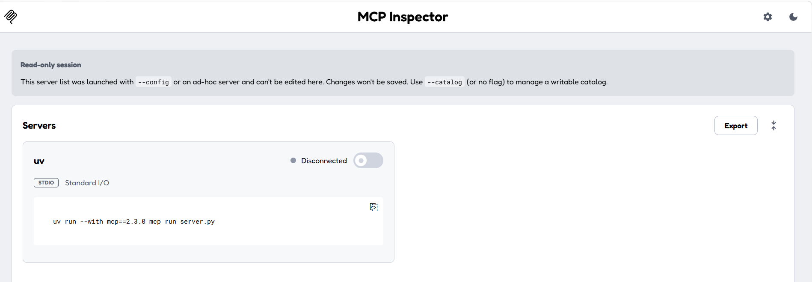
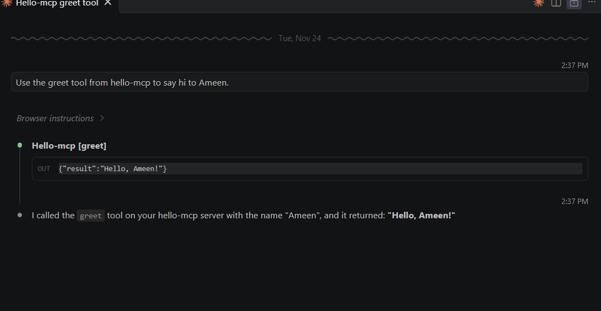

# Project 1: Build a small MCP server and connect to it

This small project shows the basics of MCP (Model Context Protocol). It walks through building a simple server in Python, testing it with MCP Inspector, and connecting it to Claude Code so Claude can use its tools.

The server is kept small on purpose. The goal is to show how MCP works under the hood, not to build something big.

## What the server does

The server is called `hello-mcp` and it has one example of each MCP building block:

| Type | Name | What it does |
|------|------|--------------|
| Tool | `add` | Adds two numbers |
| Tool | `greet` | Returns a greeting for a name |
| Resource | `info://about` | A short description of the server |
| Resource template | `greeting://{name}` | A welcome message for any name |
| Prompt | `explain_code` | A template that asks the model to explain some code |

The main difference is who decides when each one is used:

- **Tools** are called by the model. Claude decides on its own when to use them.
- **Resources** are read-only data. The user or the app decides when to add them as context.
- **Prompts** are templates the user picks, like a slash command.

## How it works

```
Claude Code (host)
   └── MCP client
         │  JSON-RPC 2.0 over stdio
         ▼
   hello-mcp server (server.py)
```

Claude Code starts `server.py` as a subprocess and talks to it through stdin/stdout. When it connects, it does a handshake (`initialize`), asks what tools are available (`tools/list`), and then calls them when needed (`tools/call`).

## Tech used

- Python 3.13
- [MCP Python SDK](https://github.com/modelcontextprotocol/python-sdk) v2 (`MCPServer`)
- [uv](https://docs.astral.sh/uv/) for dependencies and running the server
- MCP Inspector for testing
- Claude Code as the client

## How to run it

You need [uv](https://docs.astral.sh/uv/) installed.

**1. Install dependencies**

```bash
cd 01-build-a-small-server-and-connect
uv sync
```

**2. Test it with MCP Inspector**

```bash
uv run mcp dev server.py
```

Open the link it prints, connect, and try the tools, resources and prompts from the browser.



**3. Use it from Claude Code**

The `.mcp.json` file in the root of the repo already registers the server, so if you open the repo in Claude Code it will ask you to approve `hello-mcp`. After that you can just ask:

> Use the greet tool from hello-mcp to say hi to Ameen.



If you want to add it yourself instead, run this from the repo root:

```bash
claude mcp add hello-mcp --scope project -- uv --directory 01-build-a-small-server-and-connect run server.py
```

(On Windows PowerShell use `claude.cmd` instead of `claude`, otherwise PowerShell eats the `--`.)

## Things worth knowing

- **Type hints matter.** The SDK turns Python type hints into the JSON schema the model sees, and the docstring becomes the tool description. A vague docstring means the model won't know when to use the tool.
- **Don't `print()` in a stdio server.** stdout is where the JSON-RPC messages go, so any extra output breaks the connection. Logs should go to stderr.
- **Check your SDK version.** A lot of examples online still use `FastMCP`, but in SDK v2 it was renamed to `MCPServer`. Old examples will fail with an import error.
- **Resources depend on the host.** In Claude Code the model can read resources by itself, but in other apps the user may have to attach them. Same server, different behavior.
- **Project servers need approval.** Since `.mcp.json` runs a command on your machine, Claude Code asks before starting any server from a repo. A cloned repo could contain anything, so this is a good thing.
- **If the server shows as failed**, check that the command works from the same environment the client runs in. A common case: installing uv while VS Code is open means VS Code doesn't see it in PATH until you restart it.

## Next

The next project will build something more practical, like a server that connects to a real API or reads local files.
